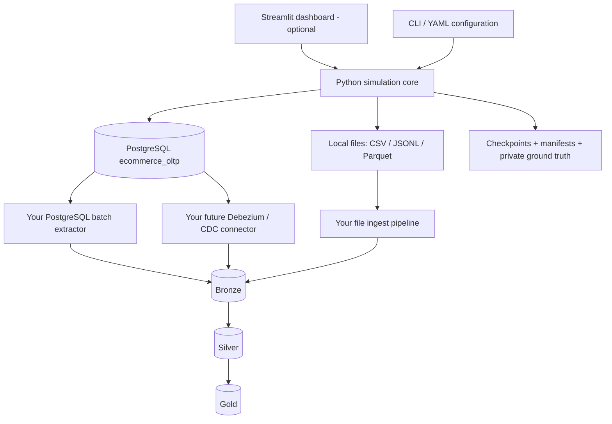

# 02 — System Architecture

## Logical diagram



## Deployment recommendation for 16 GB RAM

- One **generator container/process** (or Python venv) plus **PostgreSQL**. Streamlit may be added after CLI completion.
- Separate Compose projects: `ecommerce-source` and, later, `data-platform`. Use an explicit Docker network / configured hostnames as needed.
- Bind-mount generated files, `/srv/ecommerce-data`, and persistent checkpoints to the Ubuntu filesystem.
- Use PostgreSQL named volume or dedicated host path for its **own** database files (not alongside generated CSV files).
- Avoid launching Kafka, Spark and large generator loads at the same time until RAM is upgraded or controlled benchmarks show headroom.

## Source-system separation

| Source | Persistent destination | Primary purpose | Expected cadence |
|---|---|---|---|
| OLTP database | PostgreSQL | Accounts, catalog, orders, payments, inventory, shipping, returns | Continuous writes |
| Supplier portal | CSV files | Product updates, inventory replenishment | Daily / irregular |
| Payment processor | CSV files | Settlement, disputes, refunds | Daily, often late |
| Website/app tracking | JSONL files | Impressions, product views, carts, sessions | Continuous or replay |
| Warehouse partner | CSV or JSONL | Pick/pack/ship/delivery status | Hourly / daily |
| Analytics snapshot | Parquet | Historical bulk reads and backfill benchmarks | Configurable |
| Generator metadata | Manifests/checkpoints | Progress, integrity and anomalies | Every committed chunk |

**Do not** make PostgreSQL identical to each external feed. For example, payment settlement CSV can be delayed relative to an order's payment state; IDs and rules remain reconcilable.

## Proposed directory tree

```text
/srv/
  ecommerce-generator/             # app code or compose checkout
  ecommerce-data/
    source_feeds/
      supplier_inventory/date=YYYY-MM-DD/*.csv
      payment_settlement/date=YYYY-MM-DD/*.csv
      courier_updates/date=YYYY-MM-DD/*.jsonl
    clickstream/date=YYYY-MM-DD/*.jsonl
    snapshots/orders/year=YYYY/month=MM/*.parquet
    manifests/run_id=.../*.json
    anomaly_truth/                 # private; never mount into learner pipeline
    checkpoints/                   # durable generator state
    staging/                       # incomplete output pending atomic rename
  postgres-data/                   # only if a bind mount is chosen
  pipeline-data/                   # downstream platform; separate lifecycle
```

## PostgreSQL schema boundaries

Suggested schemas:

- `commerce`: normalized tables: customers, sellers, categories, products, warehouses, inventory, orders, order_items, payment_attempts, shipments, returns, etc.
- `integration`: transactional `outbox_events`, integration delivery records.
- `generator_meta`: run IDs, configuration hashes, cursor/checkpoint records and completed chunk markers. Restrict ordinary pipeline readers from the ground-truth data.

Use relational constraints, sensible indexes and monetary `NUMERIC` values. Avoid updating billions of rows one row at a time when bulk operations can safely preserve logic.

## Operational sequencing

1. Initialize reference data and stable business IDs.
2. Create customers, products, sellers, warehouses and inventory.
3. Advance the simulated clock; create order transactions and outbox events atomically within PostgreSQL.
4. Apply subsequent payment, shipping, inventory and return state transitions in timestamp order.
5. Materialize external feeds to a *staging* path; validate, fsync/close and publish by rename on same filesystem.
6. Commit manifest and checkpoint **after confirming durable output**; reconcile if interrupted between PostgreSQL and filesystem commits.
7. Track schema versions and exact source timestamps; simulate ingestion/arrival separately.

**Consistency model:** Cross-store operations are not atomically committed by one PostgreSQL transaction. Use deterministic IDs, checkpoints, reconciliation and idempotent file naming to converge after crashes. Don't claim distributed exactly-once delivery.

## Scaling and guardrails

- Generator max workers: start at 1–2; memory-bounded chunks (e.g., 5k–20k rows, calibrated).
- PostgreSQL bulk load via COPY for initial large imports; meaningful transactions/UPDATE/DELETE for ongoing activity and CDC.
- Files: bounded size (target 64–256 MB for large Parquet partitions, adjust to actual machine); do not create a single enormous CSV.
- Data replay: distinguish *business event time*, *source commit time*, and *file/ingestion arrival time*.
- Disk alert thresholds at e.g. 75/85/90% usage, and reserve filesystem space for PostgreSQL WAL, vacuum and temporary work.

## Architectural decision records (initial)

| Decision | Default | Reason |
|---|---|---|
| DB | PostgreSQL | Relational source and later logical CDC |
| Files | Local filesystem | Zero cloud dependency and straightforward ingestion |
| Batch file | CSV + Parquet | Legacy integration and large analytical bulk files |
| Events | JSONL | Line-level parsing, replay and corruption exercises |
| CLI / UI | CLI before Streamlit | Simpler automation, testability and operation |
| Scheduler | Built-in simulation clock, not Airflow | Keeps learning platform independently built |
| Messaging | Optional future Kafka-compatible broker | Avoid RAM and ops burden in MVP |
| Pipeline | Separate repository / Compose | Enforces realistic source/pipeline boundary |

## Future AI engineering extension — not part of the initial stack

The learner-owned Silver/Gold outputs should later feed **separate AI applications**, not the OLTP simulator: time-aware features for recommendation/forecasting, a versioned corpus of synthetic product/policy/support documents for RAG, and private labels for offline evaluation. Keep all original text, event exposures and document versions before deriving embeddings or model features. AI artifacts such as vector indexes and model checkpoints belong in a separate `/srv/ai-lab/` or dedicated repository, not in PostgreSQL's OLTP tables. On 16 GB RAM, run heavier ML and streaming workloads sequentially.

See [10_AI_ENGINEERING_READINESS.md](10_AI_ENGINEERING_READINESS.md) for source schemas and governance, and [11_AI_EVALUATION_AND_EXPERIMENTS.md](11_AI_EVALUATION_AND_EXPERIMENTS.md) for evaluation safeguards.
