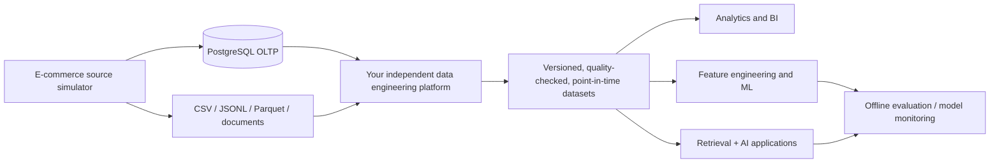

# 10 — Future AI Engineering Readiness

**Project goal update:** This homelab has two sequential purposes: (1) master reliable batch/streaming/CDC data engineering and (2) use the resulting curated data to practice **AI engineering**. The synthetic e-commerce source generator must be **AI-ready now**, without deploying an LLM, vector database, model server or training cluster in the first implementation.

## North-star workflow

The **generator owns synthetic business sources**, never the student's feature pipelines, vector indexing, model training, agent orchestration, or AI serving. It may provide private truth tables and evaluation fixtures to score work performed in separate downstream projects.

## AI use-case backlog, in recommended order

| AI application | Essential source data | Future engineering practice | Initial priority |
|---|---|---|---|
| Product recommendations | Product impressions, views, clicks, carts, purchases, customer sessions, price/inventory at event time | Point-in-time features, candidate generation, ranking, Recall@K / NDCG@K, cold starts | High |
| Search / semantic product discovery | Catalog titles, descriptions, category hierarchy, attributes, versions; search query + clicked result | Embeddings, hybrid retrieval, reranking, relevance evaluation | High |
| RAG support assistant | Versioned FAQ, store policies, seller rules, product manuals, help articles, tickets and resolved answers | Document parsing, chunking, retrieval, grounded citations, abstention | High |
| Demand forecasting | Order lines, promotions, returns, prices, availability, inventory and calendar | Temporal aggregates, backtesting, leakage-safe forecasting | Medium |
| Fraud/anomaly detection | Payment attempts, refund patterns, velocity features, synthetic abuse scenarios, delayed investigation outcomes | Imbalanced learning, PR-AUC, delayed labels, drift detection | Medium |
| Support-ticket classification | Synthetic ticket subject/body, channel, issue type, escalation, resolution and timestamps | Classification, extraction, summarization and eval | Medium |
| AI order-support agent | Read-only order, shipment, refund status, synthetic policy documents; later sandbox actions | Tool calling, authorization, workflow audit logs and success/safety tests | Later |

**Important:** The realistic input distributions matter more than raw volume. Synthetic labels can be unrealistic or too easy; record how each was generated and validate class balance, temporal behavior and relationships before drawing ML conclusions.

## Additional source contracts to plan early (implement gradually)

### Structured data in PostgreSQL

- `commerce.products`: plan optional `title`, `description`, structured `attributes_jsonb`, `language_code`, `content_version`, `published_at`, `updated_at` (retain effective-dated price and availability history elsewhere as needed).
- `commerce.search_sessions`: `search_id`, `session_id`, optional `customer_id`, `query_text`, `searched_at`, `filters`, `result_set_version`.
- `commerce.product_impressions`: `impression_id`, `search_id/session_id`, `product_id`, `position`, `candidate_source`, `shown_at`, `price_at_impression`, `availability_at_impression`. Without impressions, a no-click item is not a trustworthy negative.
- `commerce.interaction_events`: immutable `event_id`, `event_time`, `recorded_at`, `session_id`, `customer_id` (nullable), `product_id` (nullable), `interaction_type`, `source_event_id`, `schema_version`.
- `commerce.product_reviews`: `review_id`, `order_item_id` (nullable by scenario), `product_id`, `customer_id`, `rating`, `review_text`, `created_at`, `moderation_status`.
- `commerce.support_tickets` and `commerce.support_messages`: ticket lifecycle, linked order/customer IDs, timestamps, channel, synthetic conversation turns, outcome, and (later) knowledge article references.

Avoid overloading the initial OLTP with heavy model artifacts or billions of redundant event rows. High-volume raw impressions/clickstream can initially land in JSONL while stable transactional facts remain in PostgreSQL; define ownership and avoid ambiguous duplicates.

### File-based sources on your Ubuntu server

| Location (illustrative) | Format | Content |
|---|---|---|
| `/srv/ecommerce-data/ai_sources/knowledge_base/` | UTF-8 Markdown plus JSON manifest | FAQs, store/return/shipping policies, product manuals; document IDs and versions |
| `/srv/ecommerce-data/ai_sources/catalog_text/` | Parquet or JSONL | Product text snapshots with stable product IDs and effective timestamps |
| `/srv/ecommerce-data/ai_sources/search_interactions/` | JSONL, optionally compacted Parquet | Exposures, queries and engagement events |
| `/srv/ecommerce-data/ai_sources/support_conversations/` | JSONL | Synthetic support conversation turns, ticket IDs and outcomes |
| `/srv/ecommerce-data/private_ai_truth/` | JSONL or Parquet, restricted access | Scenario labels, relevance judgments, expected answer documents and gold answers |

Only **synthetic** names, messages, identities, accounts and case data. Do not generate real card data, real personal details, secrets, or use copyrighted scraped manuals as source text. Generate an original internally consistent mock product/policy corpus instead.

## Provenance, consistency and versioning — preserve from day one

For important source records, plan these metadata fields and enforce consistent IDs:

- `source_system`, `source_record_id`, `schema_version`, `generator_version`, `run_id`.
- `event_time` / `effective_from` / `effective_to` for business validity; `recorded_at`, `published_at`, and `arrived_at` where relevant.
- Immutable `customer_id`, `product_id`, `order_id`, `session_id`, `event_id`; keys must cross-reference realistically.
- `document_id`, `document_version`, `created_at`, `published_at`, `superseded_at`, `language`, `product_id` / `policy_scope` for retrieval sources.
- `scenario_id` and `seed`; store labels in a private truth ledger with the observation/decision timestamp and label-availability timestamp.

A knowledge article valid in March must not be used to answer a question about a changed policy in January. A recommendation model may use data observed **before** a prediction time, not a later refund or click outcome.

## Leakage-safe AI data design

1. Assign train/validation/test splits by **time**, not by random shuffling of transactions. Keep a final future period held out.
2. For recommendations, explicitly simulate exposure/impressions and sample evaluation candidates without incorrectly treating all unviewed products as negative feedback.
3. Simulate cold-start products/customers and temporal distribution shifts in isolated scenarios.
4. Do not expose `fraud_label`, `recommended_item_label`, `correct_answer` or anomaly truth directly in serving/source features. Store the answer key under `private_ai_truth` and record when labels become available.
5. Avoid copying future-updated catalog text, price, inventory or policies into historical training examples; reconstruct features **as of** the prediction time.
6. Include stable group IDs for sessions/tickets and avoid the same conversation leaking across training and test sets.
7. Keep a seed-independent evaluation holdout (separate scenario ranges and seeds) to avoid scoring on near-copies of generated training examples.

## Lightweight RAG corpus requirements

- Original synthetic Markdown/JSON documents: policies, product guidance, seller FAQs, delivery and return procedures; include tables or structured sections to create nontrivial retrieval challenges.
- Each document has a stable ID, title, version, effective date/time window, section IDs and links to applicable entities.
- Add realistic **controlled contradictions** only across intentionally outdated versions; manifest which version is authoritative at the question time.
- Generate queries spanning answerable, multi-document, outdated-document, ambiguous, and *unanswerable* cases.
- Store private `query_id`, expected supporting `document_id`/section IDs, expected fact(s), as-of time, and abstention flag.
- Leave chunking, embedding generation, vector indexing and LLM prompting to your **future AI app**, not the source generator.

## Resource-aware AI plan for the 16 GB homelab

- **Now:** generate and store text/relevance/source metadata without model runtime. PostgreSQL + compressed JSONL/Parquet/Markdown are enough.
- **Later, small experiments:** use Python/DuckDB to create sampled training tables; use CPU-friendly embeddings or a small model one job at a time; optional PostgreSQL `pgvector` or a separate local vector index.
- **Later, heavier training/serving:** 32 GB RAM is a helpful upgrade but not a requirement for starting. Avoid running Spark, a Kafka broker, large embedding jobs and an LLM concurrently on 16 GB.
- Cloud APIs are optional for specific AI experiments; maintain local-first, no-secret-in-code defaults and control token costs.
- Disk capacity is not GPU capability; do not promise fast local LLM training on a Ryzen 5 5600 without a suitable GPU.

## AI-readiness acceptance gates

- Catalog text remains linked to a valid product and has a version and as-of timestamp.
- Every impression/click/cart/purchase has a valid session and entity reference where required; event order is plausible.
- Each AI knowledge document has a traceable version and citation identifier.
- Label truth is segregated and **not mounted** into the learner pipeline/model training containers by default.
- A basic time-travel query can reconstruct product price/catalog/policy data *as of* a timestamp.
- RAG evaluation fixtures contain both answerable and unanswerable cases, with citeable supporting IDs.
- The data generator still works fully without an AI model, vector database or GPU.

## Do not scope-creep the MVP

At Phase 1, only reserve sensible identifiers, timestamps, schema evolution patterns, and room for later text fields. Implement rich support corpora, recommendation impression logs and private AI evaluation fixtures **after** the reliable transaction/file generator and continuous simulation are proven. Never sacrifice correct order/payment/inventory relationships just to add model-ready text.
